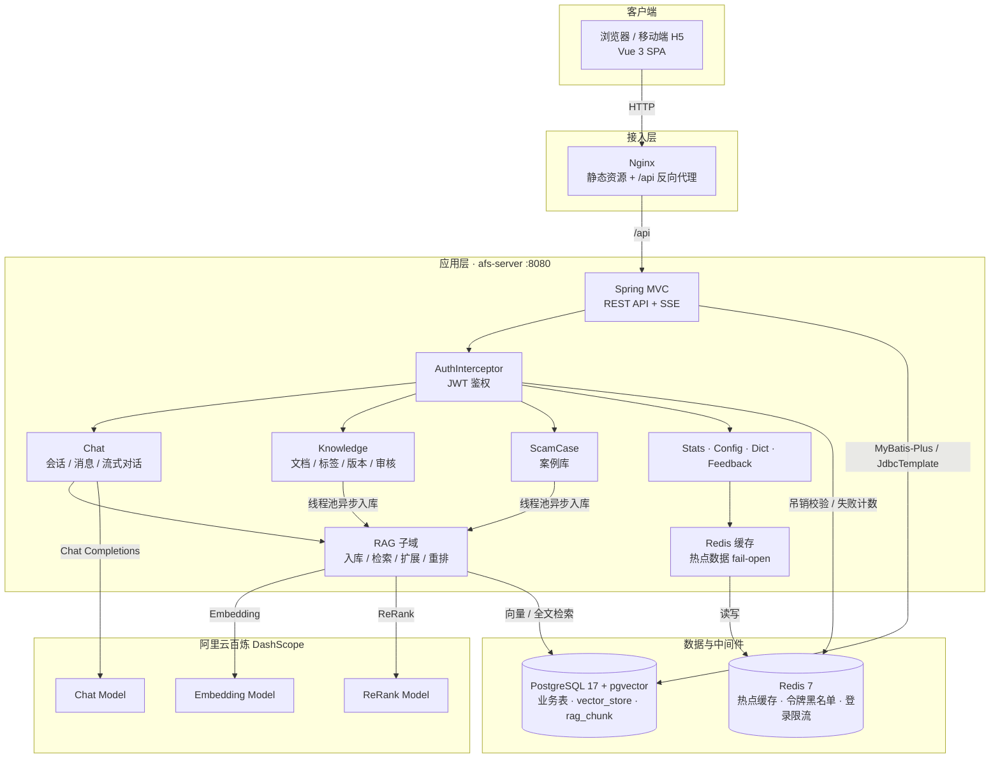
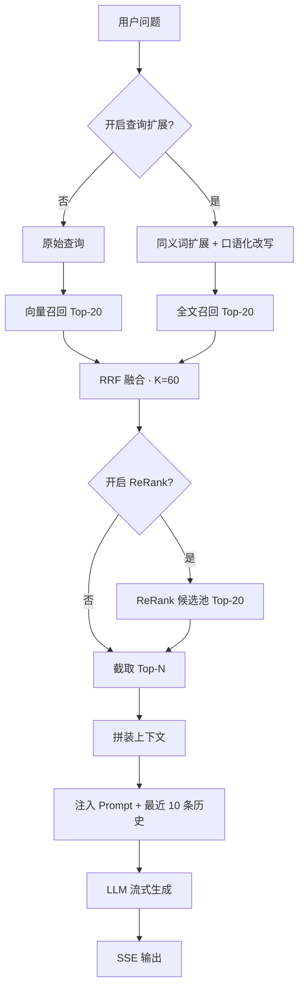
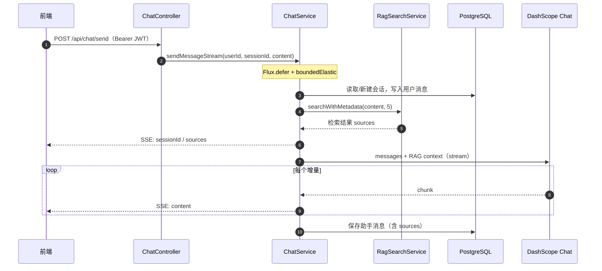
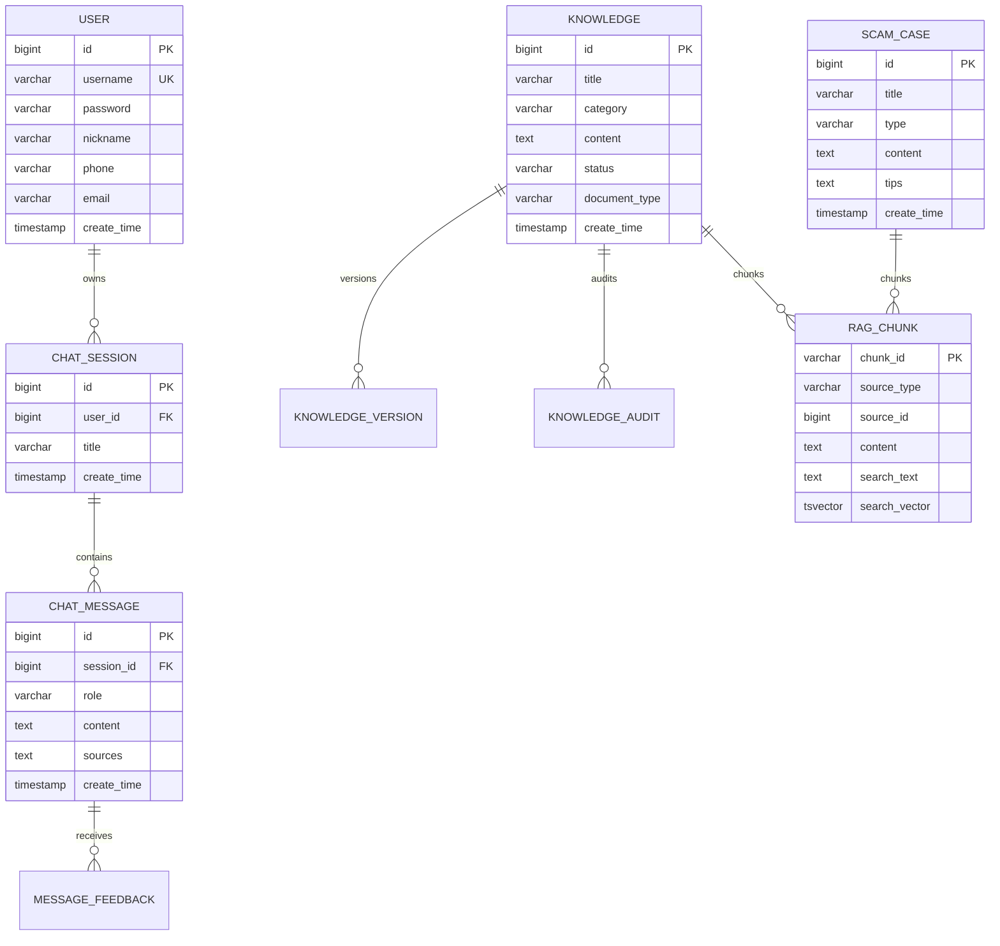

# 智能反诈系统（AFS）

基于 Spring Boot 3.4 + Spring AI + Vue 3 的防诈骗知识问答系统。系统把知识库和诈骗案例作为可信数据源，通过 RAG（检索增强生成）将相关内容注入通义千问的提示词，提供带引用来源的流式多轮问答，并配套知识库、案例库、用户与系统管理功能。


## 功能特性

- **智能问答**：多轮会话、SSE 流式输出、RAG 增强、回答附带来源引用
- **混合检索**：pgVector 向量检索 + PostgreSQL 全文检索，RRF 融合排序，支持 ReRank 重排
- **查询扩展**：反诈领域同义词扩展与口语化改写，提升关键词召回率
- **知识库**：PDF / Word / Markdown / Excel / TXT 上传解析、语义搜索、标签、版本回滚、审核流转、向量化状态跟踪
- **案例库**：诈骗案例增删改查、按类型筛选、自动同步向量索引
- **用户体系**：注册登录、JWT 鉴权、登出即吊销（Redis 令牌黑名单）、登录失败锁定防爆破、RBAC 双角色、个人资料、用户管理、BCrypt 密码加密
- **系统管理**：数据统计看板、消息反馈、系统参数配置、数据字典
- **工程能力**：统一响应结构、全局异常处理、线程池异步入库（状态机 + 启动恢复）、Redis 热点数据缓存（fail-open）、Prometheus 指标端点、JSON 结构化日志、Swagger 接口文档、Actuator 健康检查

## 技术栈

| 层次 | 技术 |
|------|------|
| 后端 | Spring Boot 3.4.4、Spring MVC、Reactor（Flux 流式返回） |
| AI | Spring AI 1.1.7、通义千问 Chat / Embedding / ReRank |
| 数据库 | PostgreSQL 17 + pgvector、MyBatis-Plus 3.5.5、Flyway 9.22.3 |
| 缓存与状态 | Redis 7（热点缓存 / 令牌黑名单 / 登录限流）、Caffeine（Spring Cache 本地缓存） |
| 可观测性 | Actuator、Micrometer + Prometheus、Logstash JSON 结构化日志 |
| 安全 | JJWT 0.12.6、Spring Security Crypto（BCrypt） |
| 文档解析 | PDFBox 3、Apache POI 5.2、CommonMark、Apache Tika 2.9 |
| 前端 | Vue 3、Vue Router 4、Pinia、Element Plus、Axios、Vite 5 |
| 部署 | Docker、Docker Compose、Nginx |

## 系统架构

### 总体架构



- 前端由 Nginx 托管，`/api` 同源反向代理到后端，避免跨域。
- 后端请求统一经过 `AuthInterceptor` 校验 JWT；注册、登录、Swagger、健康检查放行。
- 流式接口返回 `Flux<ServerSentEvent<String>>`，同步准备工作调度到 `boundedElastic`，不阻塞请求线程。
- 热点读（系统配置、数据字典）走 Redis 缓存（30 分钟 TTL），Redis 故障自动 fail-open 直连数据库。

### RAG 检索流程

离线入库：文档上传即时返回，切分与向量化提交到独立线程池异步执行；处理时回读数据库取最新内容，按 Token 切分，以 `sourceType:sourceId:index` 生成稳定 `chunkId`，同时写入 pgVector 向量库和带 `tsvector` 全文索引的 `rag_chunk` 表。处理过程驱动 `knowledge.vector_status` 状态机（PENDING → PROCESSING → SUCCESS/FAILED），前端轮询展示进度；服务重启时自动扫描中断任务重新执行，重启不丢任务。



检索参数在 [application.yml](afs-server/src/main/resources/application.yml) 中配置，默认向量与关键词通道各召回 20 条，ReRank 后保留 5 条。

多级降级：混合检索异常时退回纯向量检索；ReRank 失败保留原排序；RAG 失败退化为纯 AI 对话；AI 调用异常时返回兜底文案。

### 对话流程



SSE 与 MVC 异步超时均为 120 秒；会话和消息按 `userId` 校验归属。

### 数据模型



`vector_store` 由 Spring AI PgVector 自动创建，`rag_chunk` 与全文索引由 Flyway 脚本维护。

## 项目结构

```text
llm-afs/
├── afs-server/                  # Spring Boot 后端
│   ├── Dockerfile
│   ├── pom.xml
│   └── src/
│       ├── main/java/com/afs/
│       │   ├── common/          # Result / PageResult / ResultCode
│       │   ├── security/        # JwtUtil / 鉴权与角色拦截器 / 令牌黑名单 / 登录限流
│       │   ├── config/          # AI、异步线程池、CORS、鉴权、OpenAPI、初始化
│       │   ├── module/
│       │   │   ├── chat/        # 会话、消息、SSE 流式对话
│       │   │   ├── knowledge/   # 知识库、文档上传、标签、版本、审核
│       │   │   ├── scamcase/    # 诈骗案例库
│       │   │   ├── user/        # 注册登录与用户管理
│       │   │   ├── stats/       # 数据统计
│       │   │   ├── feedback/    # 消息反馈
│       │   │   ├── sysconfig/   # 系统参数配置
│       │   │   ├── system/      # 数据字典
│       │   │   └── rag/         # RAG 核心
│       │   │       ├── ingestion/   # 文档切分与索引写入 / 线程池派发器、处理器与中断恢复
│       │   │       ├── search/      # 策略解析、混合/向量检索、分词、过滤
│       │   │       ├── query/       # 查询扩展
│       │   │       ├── rerank/      # ReRank 重排
│       │   │       └── context/     # 上下文组装
│       │   └── util/            # DocumentParser
│       ├── main/resources/
│       │   ├── application.yml
│       │   ├── logback-spring.xml   # json-log profile 切换 JSON 结构化日志
│       │   └── db/migration/    # Flyway V1 ~ V15
│       └── test/java/com/afs/   # 单元测试
├── afs-web/                     # Vue 3 前端
│   ├── Dockerfile
│   ├── nginx.conf
│   ├── vite.config.js
│   └── src/                     # api / components / router / stores / views ...
├── docker-compose.yml
├── docker-compose.prod.yml
├── .env.example
├── deployment.md                # 服务器部署与运维说明
└── README.md
```

## 快速开始

### 环境要求

- JDK 17+、Maven 3.8+
- Node.js 18+
- PostgreSQL 17（需安装 pgvector 扩展）
- Redis 7（热点缓存 / 令牌黑名单 / 登录限流；Docker Compose 自动提供）
- Docker / Docker Compose 2.0+（推荐）
- 阿里云百炼 API Key（Chat / Embedding / ReRank）

### 使用 Docker Compose

```bash
git clone https://github.com/wxcoding/llm-afs.git
cd llm-afs

cp .env.example .env
# 至少填写 POSTGRES_PASSWORD 和 AI_DASHSCOPE_API_KEY

docker compose up -d --build
docker compose logs -f afs-server
```

| 入口 | 地址 |
|------|------|
| 前端 | http://localhost:3000 |
| 后端 API | http://localhost:8080 |
| Swagger UI | http://localhost:8080/swagger-ui.html |
| 健康检查 | http://localhost:8080/actuator/health |
| Prometheus 指标 | http://localhost:8080/actuator/prometheus |

首次启动会自动执行数据库迁移、初始化默认数据并同步向量库。Embedding 未配置时同步失败只记录告警，不影响服务启动。

### 本地开发

```sql
CREATE DATABASE afs;
\c afs
CREATE EXTENSION IF NOT EXISTS vector;
```

```bash
# 只启动数据库与中间件依赖（首次需 cp .env.example .env）
docker compose up -d postgres redis
```

```bash
# 后端
cd afs-server
mvn spring-boot:run

# 前端
cd afs-web
npm install
npm run dev
```

Vite 开发服务器监听 `3000`，并将 `/api` 代理到 `http://localhost:8080`。

## 配置说明

| 变量 | 必填 | 默认值 / 说明 |
|------|:----:|---------------|
| `POSTGRES_PASSWORD` | 是 | 数据库密码 |
| `AI_DASHSCOPE_API_KEY` | 是 | 阿里云百炼 API Key |
| `JWT_SECRET` | 生产必填 | 覆盖内置开发密钥 |
| `REDIS_HOST` / `REDIS_PORT` / `REDIS_PASSWORD` | 否 | `redis` / `6379` / 空（本地开发默认 `localhost`） |
| `AI_DASHSCOPE_MODEL` | 否 | `qwen3.8-flash`（应用）/ `qwen3.8-max-0902`（Compose） |
| `POSTGRES_USER` / `POSTGRES_DB` / `POSTGRES_PORT` | 否 | `postgres` / `afs` / `5432` |
| `SERVER_PORT` / `WEB_PORT` | 否 | `8080` / `3000` |
| `SPRING_PROFILES_ACTIVE` | 否 | 容器环境默认 `json-log`（JSON 结构化日志），本地开发默认文本日志 |
| `SPRINGDOC_API_DOCS_ENABLED` / `SPRINGDOC_SWAGGER_UI_ENABLED` | 否 | 生产环境默认 `false` |

其余环境变量见 [.env.example](.env.example)；RAG、登录防爆破策略、JWT 有效期等参数见 [application.yml](afs-server/src/main/resources/application.yml)。生产部署时请务必覆盖数据库密码和 JWT 密钥。

## 接口说明

接口统一前缀为 `/api`，除注册、登录、Swagger 和健康检查外，均需携带 `Authorization: Bearer <JWT>`。登录连续失败 5 次将锁定 10 分钟（返回 429）；调用 `/user/logout` 后令牌立即吊销。普通接口统一返回：

```json
{ "success": true, "message": "操作成功", "data": {}, "code": 200, "timestamp": 1730000000000 }
```

| 模块 | 主要接口 |
|------|----------|
| 用户认证 | `POST /user/register`、`/user/login`、`/user/logout`；`GET /user/{id}`；`PUT /user/update` |
| 智能对话 | `POST /chat/send`（SSE）；`GET /chat/sessions`、`/chat/history/{id}`；`PUT/DELETE /chat/session/{id}` |
| 知识库 | `/knowledge` CRUD；`/search/semantic`；`/sync-vector`；`/upload(/batch)`；`/tags/**`、`/versions/**`、`/audit/**` |
| 案例 | `/cases` CRUD，支持 `?type=` 筛选 |
| 统计与系统 | `/stats`；`/feedback/**`；`/config/**`；`/sys/dict/**` |

`POST /api/chat/send` 返回 `text/event-stream`，主要事件数据格式：

```text
data: {"sessionId":42}
data: {"sources":[{"title":"电信诈骗防范","source":"知识库","score":0.93}]}
data: {"content":"您好，我是防诈骗助手"}
```

完整参数和响应请启动后访问 Swagger UI 查看。

## 数据库与迁移

数据库结构由 Flyway 在启动时自动迁移，脚本位于 [db/migration](afs-server/src/main/resources/db/migration)，当前为 `V1 ~ V15`。

主要数据表：

| 表 | 用途 |
|----|------|
| `user` | 用户账号与资料 |
| `chat_session` / `chat_message` | 会话与消息，含 RAG 来源 |
| `knowledge` | 知识文档、状态与文件信息、`vector_status` 向量化状态机 |
| `knowledge_tag` / `knowledge_version` / `knowledge_audit` | 标签、版本与审核 |
| `scam_case` | 诈骗案例 |
| `message_feedback` | 消息反馈 |
| `system_config` / `sys_dict_*` | 系统配置与字典 |
| `vector_store` / `rag_chunk` | 向量索引与全文检索分块 |

## 测试与构建

```bash
# 后端：46 个测试类、382 个单元测试（Mockito + MockMvc，不依赖数据库与 Spring 容器）
cd afs-server
mvn test
mvn clean package -DskipTests

# 前端
cd afs-web
npm run lint
npm run build
```

## 设计亮点

- **RAG 全链路自研可控**：文档切分、稳定 chunkId、向量/全文双通道召回、RRF 融合、ReRank、上下文组装均在后端显式实现，每个环节可独立配置与降级
- **异步入库 + 状态机**：文档上传即时返回，独立线程池异步完成切分与向量化（队列满时 CallerRunsPolicy 背压）；`vector_status` 状态机（PENDING → PROCESSING → SUCCESS/FAILED）全程可追溯，前端轮询展示进度；任务只携带记录 ID，处理时回读数据库取最新内容，避免快照过期；服务启动时自动扫描并恢复中断任务
- **故障降级**：缓存 Redis 故障 fail-open 直连数据库；混合检索 → 纯向量 → 纯 AI 对话 → 兜底文案，任一外部依赖异常不影响主流程可用性
- **流式背压**：SSE + `Flux.defer` + `boundedElastic`，数据库读写等阻塞操作不占用 Tomcat 请求线程
- **安全闭环**：JWT 无状态鉴权 + Redis 黑名单实现"可吊销的无状态令牌"；登录失败计数锁定防爆破；密码 BCrypt 加密；RBAC 角色拦截
- **可观测性**：Actuator + Prometheus 指标端点（`/actuator/prometheus`），`json-log` profile 一键切换 JSON 结构化日志，可直接接入 ELK / Loki 采集

## 演进方向

- 引入消息队列（RabbitMQ / RocketMQ）承载入库任务，支撑多实例部署与流量削峰，失败任务接入死信队列补偿重试
- 热点数据多实例部署时可演进为 Caffeine + Redis 两级缓存，并用 Redis 发布订阅广播失效
- 接入 Grafana 看板与告警规则，消费积压、索引失败率可视化
- Testcontainers 集成测试覆盖 Flyway 迁移与 Mapper 层（当前为纯单元测试）
- 开启 GitHub Actions CI（仓库内已有模板 `.github/workflows/ci-cd.disabled.yml`）

## 部署

```bash
cp .env.example .env
vim .env
docker compose -f docker-compose.prod.yml up -d
```

服务器初始化、备份恢复和安全配置等详细步骤见 [deployment.md](deployment.md)。

## 常见问题

**向量库同步失败还能用吗？** 可以，问答会退化为纯 AI 对话或返回兜底文案。

**提示 `extension "vector" is not available`？** 确认使用 `pgvector/pgvector:pg17` 镜像，或在数据库中执行 `CREATE EXTENSION IF NOT EXISTS vector;`。

**流式回答前端长时间空白？** Nginx 默认开启 `proxy_buffering`，可在 `/api/` 代理配置中关闭缓冲并调大 `proxy_read_timeout`。

**登录提示账号已锁定？** 连续输错密码 5 次会锁定 10 分钟（Redis 计数，窗口到期自动解锁）。

**登出后原 Token 还能用吗？** 不能。登出会将令牌写入 Redis 黑名单直至其自然过期，期间任何请求都会被拒绝。
