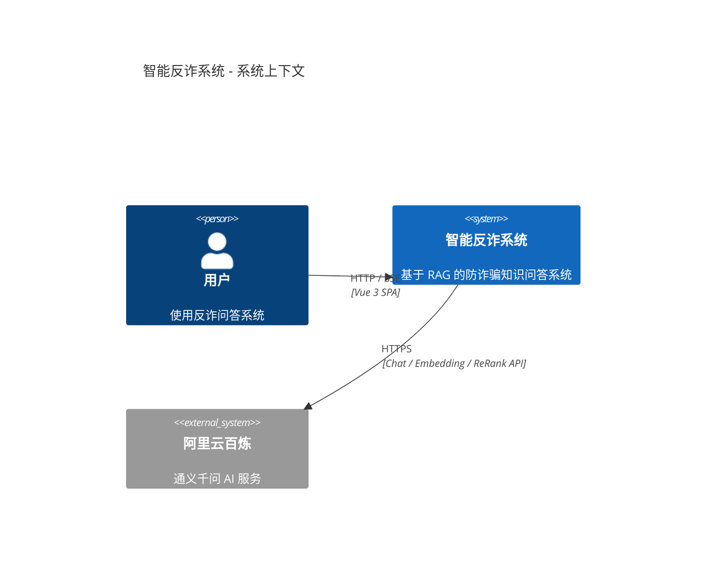
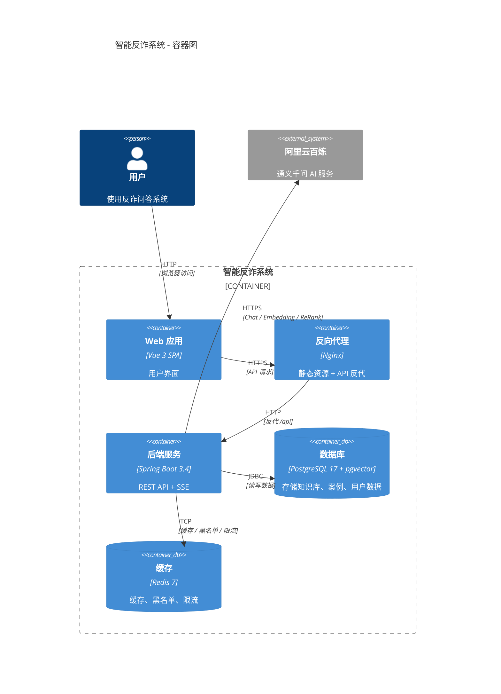
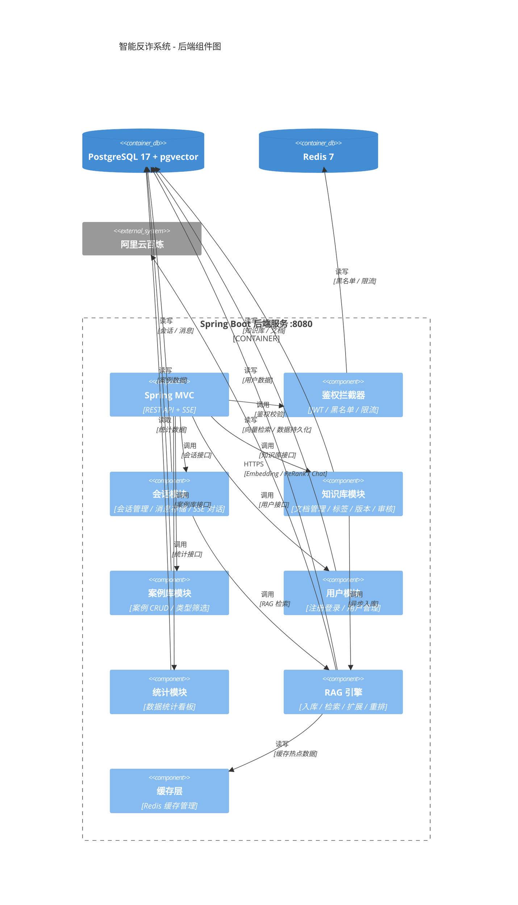
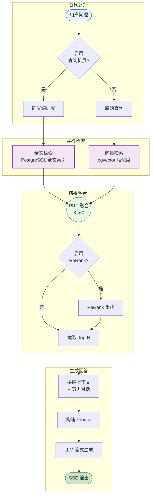

# 系统架构

## System Context（系统上下文）



## Container Diagram（容器图）



## Component Diagram（组件图）



## RAG 检索流程



### 流程说明

1. **查询扩展**（可选）：通过同义词扩展和口语化改写，提升反诈场景的召回率
2. **并行检索**：同时进行全文检索和向量检索，互补提升召回效果
3. **结果融合**：使用 RRF（Reciprocal Rank Fusion）算法融合双通道结果，参数 K=60
4. **ReRank 重排**（可选）：使用阿里云 ReRank 模型对结果进行精排
5. **上下文组装**：截取 Top-N 结果，拼接历史对话，构造完整上下文
6. **LLM 生成**：构造 Prompt，调用通义千问模型，SSE 流式输出

### 多级降级策略

```
混合检索异常 → 纯向量检索 → RAG 失败退化为纯 AI 对话 → AI 异常返回兜底文案
```

- **检索降级**：混合检索失败时，降级为纯向量检索
- **RAG 降级**：检索失败时，退化为纯 AI 对话（不注入知识库内容）
- **兜底文案**：AI 调用失败时，返回预设的友好提示文案
- **缓存降级**：Redis 故障时采用 fail-open 策略，不影响主流程

## 数据流向说明

**整体数据流**：
- 用户 → Web 应用 → Nginx → Spring Boot → PostgreSQL / Redis / 阿里云百炼

**RAG 检索数据流**：
- 用户问题 → 查询扩展 → 并行检索（全文+向量）→ RRF 融合 → ReRank → 上下文组装 → LLM 生成 → SSE 输出

## 核心模块说明

### RAG 引擎

- **ingestion**：文档切分、索引写入、线程池派发、中断恢复
- **search**：策略解析、混合/向量检索、分词、过滤
- **query**：查询扩展（同义词、口语化）
- **rerank**：ReRank 重排
- **context**：上下文组装

### 业务模块

- **chat**：会话管理、消息存储、SSE 流式对话
- **knowledge**：知识库管理、文档上传、标签、版本、审核
- **scamcase**：诈骗案例 CRUD、类型筛选、向量索引同步
- **user**：注册登录、用户管理
- **stats**：数据统计看板
- **feedback**：消息反馈管理
- **sysconfig**：系统参数配置
- **system**：数据字典管理

### 安全模块

- **JWT 鉴权**：基于 JWT 的用户认证
- **黑名单机制**：登出即将令牌加入 Redis 黑名单，实现可吊销
- **登录限流**：失败计数防爆破
- **RBAC**：双角色权限控制
- **BCrypt**：密码加密存储
